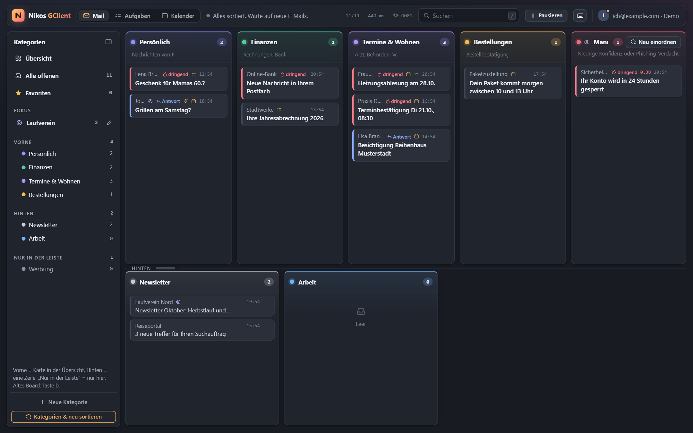
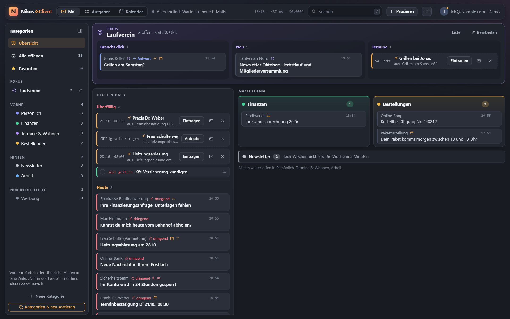
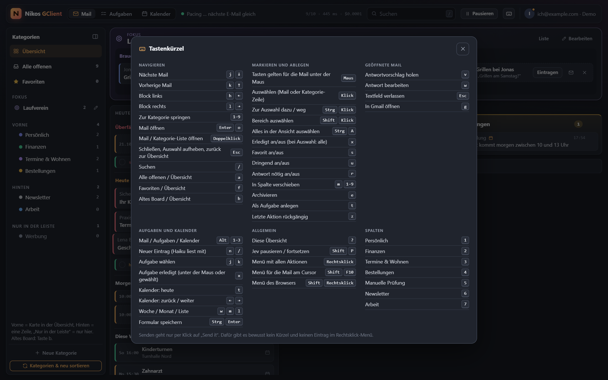
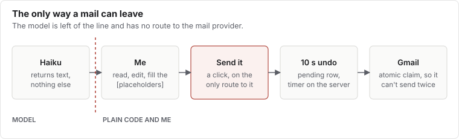
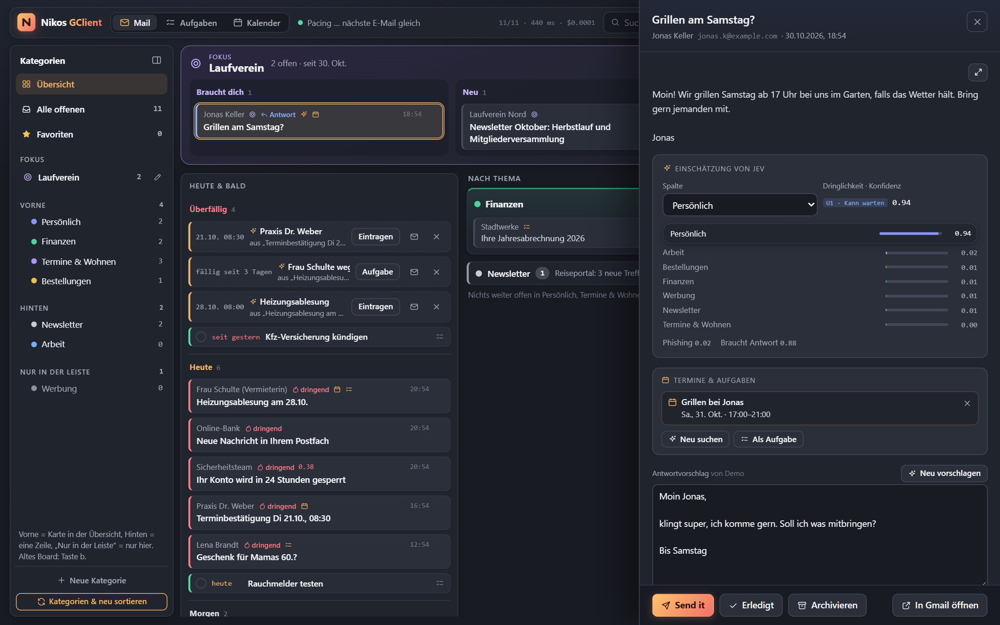
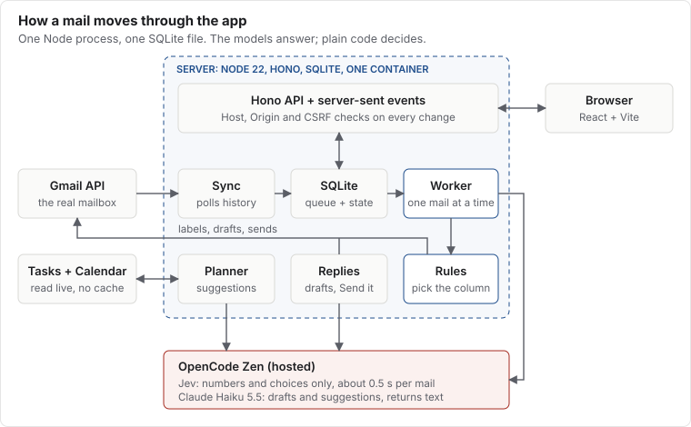

Vor zwei Wochen hatte ich einen einfachen Plan: Eine KI sortiert meinen Gmail-Posteingang in Spalten, wie ein
Kanban-Board. Mail kommt rein, ein Modell liest sie, die Karte landet am richtigen Platz.

Das Sortieren war nie das Schwierige. Ich habe aber die nächsten zwei Wochen gebraucht, um zu merken, dass ein
aufgeräumter Posteingang gar nicht das ist, was ich wollte.

Das Ergebnis heißt Nikos GClient. Es ist eine kleine Web-App auf meinem Heimserver, die meine Mails sortiert, Termine
und Aufgaben darin findet und auf Wunsch Antworten entwirft. Claude (eine KI) hat den Code geschrieben; ich habe die App
jeden Tag benutzt und gesagt, was nicht passt. Es ist ein privates Werkzeug, deshalb gibt es hier keinen Download-Link,
nur das, was ich dabei gelernt habe.

## Sortieren ist der leichte Teil

Ein schnelles, günstiges Modell namens Jev liest jede neue Mail und wählt eine Kategorie. Das dauert etwa eine halbe
Sekunde pro Mail, und der Worker schafft ungefähr 40 pro Minute, eine nach der anderen. Das Modell läuft über OpenCode
Zen, einen gehosteten Dienst, Mail-Text verlässt also mein Haus. Diesen Kompromiss bin ich bewusst eingegangen, und der
Datenschutzhinweis der App nennt ihn auch.

Die erste Version war zu kompliziert und schrumpfte noch am selben Abend auf vier Spalten. Sechs Tage später wuchs sie
wieder: zehn Kategorien, eine Seitenleiste und zwei Reihen Spalten, damit mehr Themen ohne seitliches Scrollen Platz
haben.

Überraschend war, wie wenig das Modell braucht. Es entscheidet allein nach Name und Beschreibung einer Kategorie. Die
eigentliche Arbeit steckt deshalb in den Beschreibungen: Sie nennen typische Absender und sagen, was in die
Nachbarkategorie gehört. Ein Zahlungsbeleg zu einer Bestellung kommt zu „Bestellungen & Versand“, nicht zu den
Rechnungen. Ein Login-Code kommt zu „Konten & Sicherheit“.

Ändere ich diese Beschreibungen, bewertet Jev in einem Probelauf die 20 neuesten Mails und speichert nichts. Erst danach
startet das echte Neusortieren.

## Das Board war nicht die Lösung

Nach neun Tagen Spalten-Feintuning musste ich es zugeben: Das Kategorie-Board war nicht die Antwort. Gmail-artige
Sektionen auch nicht. Auch sauber nach Thema abgelegte Mails ließen mich allein mit der Frage, was heute wirklich
von mir gebraucht wird.

Also änderte sich die Startseite von „Worum geht es?“ zu „Was muss ich tun?“. Jede offene Mail erscheint jetzt genau
einmal, in dieser Reihenfolge:

1. **Fokus:** ein Thema, um das ich mich gerade kümmere, ganz oben.
2. **Heute & bald:** dringende Mails, Mails, die auf Antwort warten, dazu Termine und Aufgaben der nächsten sieben Tage.
3. **Nach Thema:** alles andere, in den alten Kategorien, mit einem Klick lässt sich eine ganze Gruppe erledigen.

Wegen dieses zweiten Blocks bekam die App einen Kalender und eine Aufgabenliste. Beide lesen live aus Google, ohne
Cache, Google bleibt also die einzige Quelle, und alles andere funktioniert weiter. Jev markiert Mails, die nach Termin
oder To-do aussehen, dann liest Claude Haiku sie und schlägt einen Eintrag vor. In meinem Kalender landet nichts, bevor
ich klicke.

Das Fokus-Thema mag ich am liebsten. Ich gebe ihm einen Namen, ein paar Stichworte und eine Dauer, und Jev bewertet im
Hintergrund alle offenen Mails der letzten 60 Tage danach. Was ich von Hand hinein- oder herausnehme, gewinnt immer.

Das alte Board gibt es noch, einen Tastendruck entfernt, bis klar ist, dass es niemand vermisst.

## Tastatur zuerst, Maus willkommen

Die App leiht sich ihre Tastenkürzel, statt neue zu erfinden, meine Finger kannten deshalb schon das meiste. Mit `?`
erscheinen alle Kürzel auf einem Bildschirm, dieselbe Gewohnheit, die uns Gmail und GitHub beigebracht haben.

| Tasten | Was sie tun | Woher die Gewohnheit kommt |
| --- | --- | --- |
| `j` `k` oder Pfeile | Nächste, vorherige Mail | Gmail, davor vim |
| `h` `l` | Block links, rechts | vim |
| `Enter` oder `o` | Mail öffnen | Gmail |
| `/` | Suchen | Gmail, GitHub und viele andere |
| `e` | Archivieren | Gmail |
| `s` | Stern | Gmail |
| `z` | Letzte Aktion rückgängig | Gmail |
| `Esc` | Schließen, Auswahl aufheben, zurück | Überall |
| `Ctrl+A`, `Ctrl`/`Shift`+Klick | Alles, einzelne, Bereich auswählen | Dateimanager |
| `Shift+F10` oder Menütaste | Kontextmenü | Windows |
| `Ctrl+Enter` | Aufgaben- oder Terminformular speichern | Webformulare und Chat-Apps |
| `x` | Erledigt | Eigene Bedeutung; in Gmail wählt es aus |

`Ctrl+Enter` ist der spannende Fall. In Gmail sendet es die Mail. Hier speichert es nur ein Formular, und fürs Senden
gibt es gar kein Kürzel. Muskelgedächtnis ist genau das, wovor ein Senden-Knopf sicher sein sollte.

Das schönste Detail sieht man nicht. Kürzel gelten für die Mail unter der Maus, wenn die Maus nach der letzten
Pfeiltaste bewegt wurde, sonst für den Tastatur-Cursor. So kann ich auf eine Mail zeigen und mehrmals hintereinander `x`
drücken, weil die nächste Mail unter den Zeiger rutscht.

Noch ein paar Dinge, durch die sich die App zeitgemäß anfühlt:

- **Überall rückgängig:** `z` nimmt die letzte Aktion zurück, und viele auf einmal erledigte Mails haben ein einziges Rückgängig.
- **Mehrfachauswahl:** Klick wählt aus, Doppelklick öffnet, und `x` erledigt alles Ausgewählte.
- **Schnelleingabe:** „Zahnarzt Do 15:30“ auf den Planer-Seiten eingetippt ergibt einen Eintrag.
- **Rechtsklick-Menü:** Es löst dieselben Funktionen aus wie die Tasten, das Browser-Menü bleibt ein Shift entfernt.
- **Handy-Layout:** Unter 760 px gibt es eine untere Leiste, eine Spalte und Tippflächen von mindestens 44 px.
- **Changelog in der App:** Jeder Commit bringt seinen eigenen Eintrag mit, und ein Test prüft Reihenfolge, Datum und Textlänge.

## Die KI darf schreiben, senden kann nur ich

Eine Regel gilt seit dem Anfang: Nichts geht ohne Klick auf „Send it“ raus, und dieser Klick kommt mit zehn Sekunden
zum Rückgängigmachen. Es gibt bewusst kein Tastenkürzel fürs Senden und keinen Eintrag im Rechtsklick-Menü. Der Kalender
folgt derselben Regel: Einträge werden ohne Gäste geschrieben, es kann also keine Einladung versehentlich rausgehen.

Das erzwingt der Code, nicht nur die Oberfläche. Der Code, der Entwürfe schreibt, sieht den Mail-Anbieter nie. Der
einzige Weg zum Senden führt über den Freigabe-Schritt, ein Rückgängig-Fenster auf dem Server und den Ausführungs-Schritt,
und die Freigabe ist nur über die „Send it“-Route erreichbar. Die Ausführung beansprucht die Datenbankzeile atomar, eine
Mail kann also nicht doppelt rausgehen.

Für die Entwürfe habe ich Claude Haiku 5.5 gewählt, weil es offene Entscheidungen als Platzhalter stehen lässt, statt
in meinem Namen etwas zuzusagen. Bei einem Werkzeug, das in meinem Namen schreibt, zählt das mehr als Stil.

Anfangs bekam jede einsortierte Mail automatisch einen Entwurf. Das war ein Fehler: Gmail lief voll mit Entwürfen, und
die Tokens kosteten Geld für Antworten, die ich nie gesendet habe. Seit dem 27. Oktober entsteht ein Entwurf nur noch,
wenn ich darum bitte. Automatisierung klang super, bis ich gesehen habe, was dabei herauskam.

## Unter der Haube

Die Architektur ist absichtlich langweilig: ein Node-22-Prozess, Hono für die API, React und Vite für die Oberfläche
und eine SQLite-Datei über better-sqlite3. Das sind etwas über 9.000 Zeilen TypeScript mit 119 Tests, ohne Message
Broker und ohne eigenen Datenbankserver.

**Polling statt Push.** Sync fragt die History-API von Gmail nach Änderungen, standardmäßig alle 30 Sekunden. Push über
Pub/Sub bräuchte ein Cloud-Topic und einen zusätzlichen Service-Account-Schlüssel. Für ein Postfach kostet Polling so
gut wie nichts.

**Eine Warteschlange in einer Tabelle.** Neue Mails bekommen den Status `queued`, und der Worker nimmt eine nach der
anderen. Die Aufrufe sind von Start zu Start getaktet, um unter dem Minutenlimit des Gateways zu bleiben. Fehlschläge
warten exponentiell länger, bis zu zwei Minuten, und beachten `Retry-After`.

**Das Modell antwortet, der Code entscheidet.** Jev bekommt die Mail und ein paar Fragen und liefert nur Auswahlen und
Zahlen, nie freien Text. Kleine, einfache Funktionen entscheiden danach. Ein Phishing-Wert über 0,5 oder eine Konfidenz
unter 0,7 schickt die Mail in eine Prüfspalte, egal wie sicher die Kategorie aussieht.

**Mails sind nicht vertrauenswürdig.** Die Sortier-Antwort kann keine Anweisungen enthalten, eine böswillige Mail kann
also schlimmstenfalls falsch einsortiert werden. Haiku schreibt dagegen Text, deshalb steht der Verlauf in einem
markierten Block, und der Prompt sagt, dass das Inhalt ist und keine Anweisung. Außerdem hat Haiku keine Werkzeuge, nur
eine Textantwort.

**Live ohne Cache.** Ein Event-Bus im Prozess schiebt Änderungen per Server-Sent Events an offene Tabs. Der Planer hält
keine Kopie von Googles Daten: nur, aus welcher Mail ein Eintrag entstand, und offene Vorschläge.

**Kleiner Schadensradius.** Geheimnisse liegen mit `systemd-creds` verschlüsselt auf der Platte. Der Container startet
nur als root, um sie zu lesen, und wechselt dann endgültig zu einem unprivilegierten Benutzer. Er läuft ohne alle
anderen Capabilities, mit schreibgeschütztem Dateisystem und `no-new-privileges`. Die Google-Tokens liegen mit
AES-256-GCM verschlüsselt in SQLite. Die API prüft den Host-Header gegen DNS-Rebinding, und jede Änderung braucht den
richtigen Origin und ein CSRF-Token.

## Was mich erwischt hat

**HTML-Mails sicher anzeigen.** Mails sind feindliche Eingaben, deshalb werden sie in einem Sandbox-iframe dargestellt.
Die Sandbox erlaubt Same-Origin-Zugriff, damit die App die Höhe messen und Tastendrücke weiterreichen kann, aber sie
erlaubt nie Skripte. Kombiniert man `allow-scripts` mit `allow-same-origin`, könnte eine Mail in die App selbst greifen.
Externe Bilder bleiben gesperrt, bis ich klicke, und eine zweite Content Security Policy im Frame setzt das durch.

**Googles Sieben-Tage-Klippe.** Eine OAuth-App im Status „Testing“ verliert ihre Tokens nach sieben Tagen. Meine stand
am 23. Oktober am Nachmittag still, mit `invalid_grant` überall im Log. Die Lösung ist, die App auf „In production“ zu
stellen. Dafür braucht sie eine Startseite und eine Datenschutzerklärung, das sind jetzt zwei kleine GitHub-Pages-Seiten.

**Ein Filter, der zu viel filtert.** Alle offenen Aufgaben verschwanden von der Aufgabenseite. `completedMin` gilt bei
Google Tasks für jede Aufgabe, und offene Aufgaben haben kein Erledigt-Datum, also fallen sie heraus. Die App holt
offene und erledigte Aufgaben jetzt getrennt.

**Testdaten sind zu höflich.** Lange Betreffzeilen schoben Knöpfe aus ihrer Box, aber die Demo-Mails waren zu kurz, um
das zu zeigen. Die Grid-Spalten brauchten `minmax(0, 1fr)`, und beim Testen kommen jetzt absichtlich lange Texte hinein.

## Mit Claude an meinen eigenen Mails arbeiten

Die interessanteste Regel steht nicht im Code: Claude öffnet die Live-App nie im Browser, weil die Seite meine echten
Mails zeigt. Es arbeitet mit einer lokalen Demo mit erfundenen Mails, liest Server-Logs über SSH und fragt mich, wenn es
wissen muss, was ich gesehen habe. Deshalb konnten die kurzen Betreffzeilen der Demo auch einen Fehler verstecken, den
mein echter Posteingang sofort gefunden hat.

Das Tempo hat verändert, wie ich entscheide. Wenn eine neue Startseite einen Abend dauert, kann ich die falsche Idee ein
paar Tage benutzen und dann ersetzen, statt sie vorher durchzudenken. Das Board war es wert, gebaut zu werden, denn erst
beim Benutzen habe ich gesehen, was ich eigentlich wollte.

Die letzte Änderung war klein: Ein Klick wählt eine Mail jetzt aus, statt sie zu öffnen, so kann ich mehrere auf einmal
erledigen. So etwas wünscht man sich erst, wenn ein Werkzeug Teil des Alltags geworden ist.
