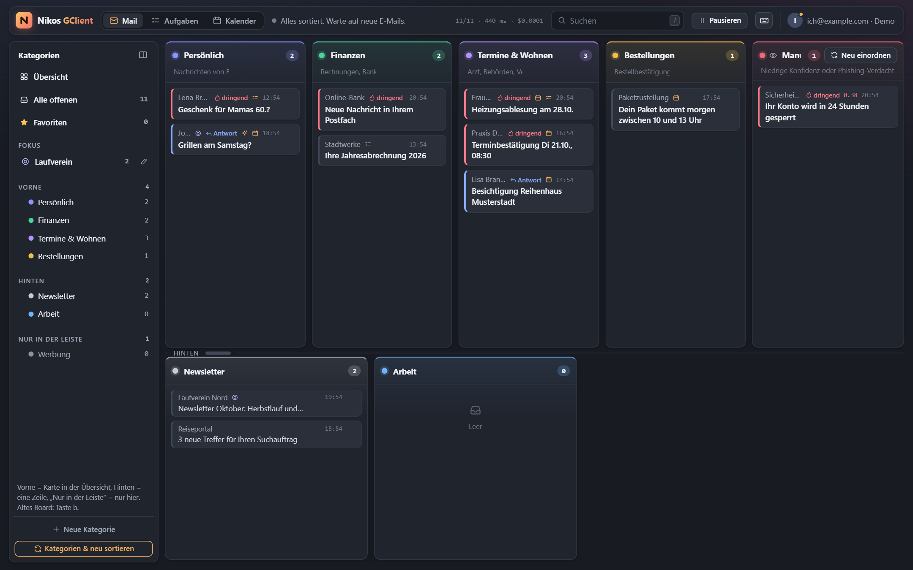
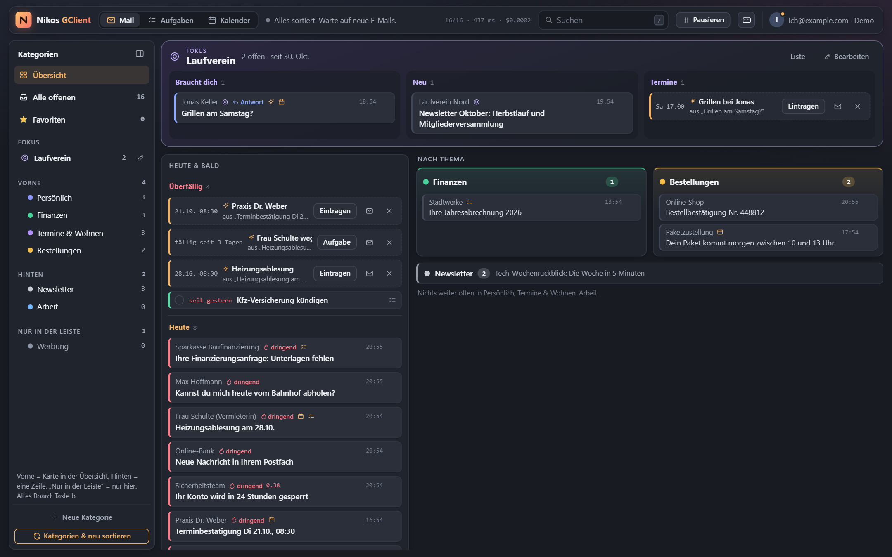
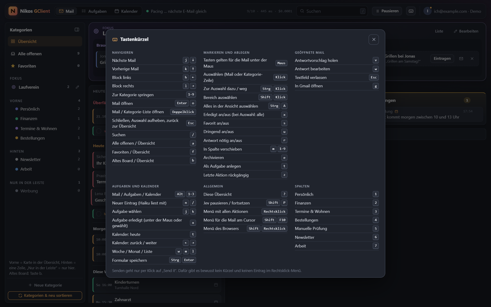
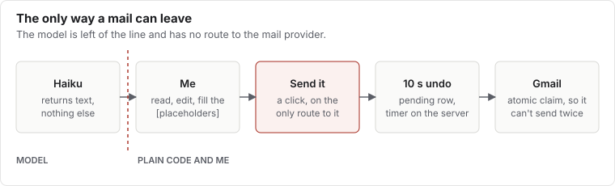
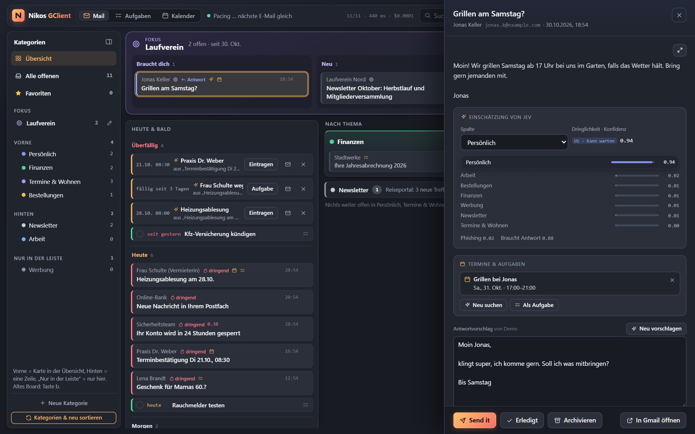
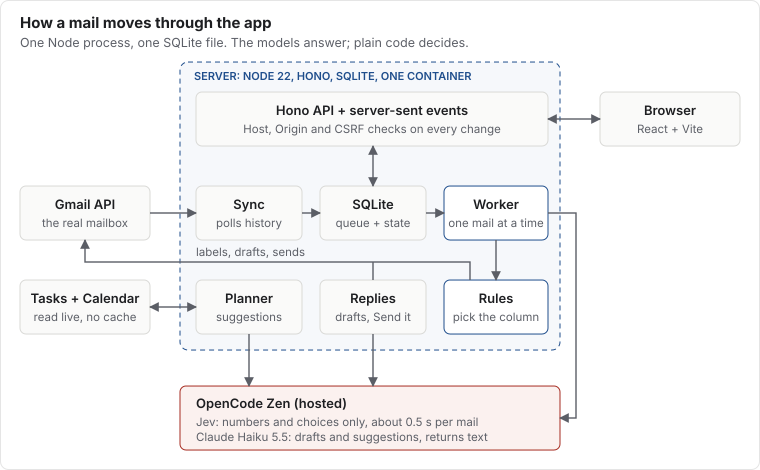

Two weeks ago I had a simple plan: let an AI sort my Gmail inbox into columns, like a Kanban board. Mail comes in, a
model reads it, the card lands in the right place.

The sorting was never the hard part. It took me the next two weeks to learn that a tidy inbox isn't what I wanted.

The result is called Nikos GClient. It's a small web app on my home server that sorts my mail, finds appointments and
tasks in it, and drafts replies when I ask. Claude (an AI) wrote the code; I used it every day and said what was wrong.
It's a private tool, so this post has no download link, just what I learned.

## Sorting is the easy part

A fast, cheap model called Jev reads each new mail and picks a category. It takes about half a second per mail, and
the worker gets through roughly 40 a minute, one at a time. It runs through OpenCode Zen, a hosted service, so mail
text does leave my house. That's a trade-off I accepted, and the app's privacy notice states it.

The first version was too complicated, and that same evening it shrank to four columns. Six days later it grew again:
ten categories, a sidebar and two rows of columns, so that more topics fit without sideways scrolling.

The surprise was how little the model needs. It decides from a category's name and description alone. So the
descriptions do the real work: they list typical senders and say what belongs next door. A payment receipt for an
order goes to Orders & Shipping, not Bills. A login code goes to Accounts & Security.

When I change those descriptions, a dry run lets Jev rate the 20 newest mails and saves nothing. Only then does the
real re-sort start.

## The board was not the solution

After nine days of tweaking columns, I had to admit it: the category board wasn't the answer. Neither were Gmail-style
sections. Mail neatly filed by topic still left me to work out what needed me today.

So the start page changed from "what is this about?" to "what do I have to do?". Every open mail now appears exactly
once, in this order:

1. **Focus:** one topic I'm currently dealing with, shown at the top.
2. **Today & soon:** urgent mail, mail waiting for a reply, plus appointments and tasks from the next seven days.
3. **By topic:** everything else, in the old categories, with one click to mark a whole group as done.

That second block is why the app grew a calendar and a task list. Both read live from Google with no cache, so Google
stays the only source and everything else keeps working. Jev flags mail that looks like an appointment or a to-do,
then Claude Haiku reads it and suggests an entry. Nothing lands in my calendar until I click.

The focus topic is the part I like best. I give it a name, some keywords and a duration, and Jev scores all open mail
from the last 60 days against it in the background. Anything I pin in or out by hand always wins.

The old board is still there, one keypress away, until it's clear nobody misses it.

## Keyboard first, mouse welcome

The app borrows shortcuts instead of inventing them, so my fingers already knew most of it. Press `?` and every
shortcut appears on one screen, the same habit Gmail and GitHub taught us.

| Keys | What it does | Where the habit comes from |
| --- | --- | --- |
| `j` `k` or arrows | Next, previous mail | Gmail, and vim before it |
| `h` `l` | Block left, right | vim |
| `Enter` or `o` | Open mail | Gmail |
| `/` | Search | Gmail, GitHub and many more |
| `e` | Archive | Gmail |
| `s` | Star | Gmail |
| `z` | Undo last action | Gmail |
| `Esc` | Close, clear selection, go back | Everywhere |
| `Ctrl+A`, `Ctrl`/`Shift`+click | Select all, some, a range | File managers |
| `Shift+F10` or menu key | Context menu | Windows |
| `Ctrl+Enter` | Save a task or appointment form | Web forms and chat apps |
| `x` | Mark done | Own meaning; in Gmail it selects |

`Ctrl+Enter` is the interesting one. In Gmail it sends the mail. Here it only saves a form, and sending has no shortcut
at all. Muscle memory is exactly what a send button should be safe from.

The nicest detail is invisible. Shortcuts act on the mail under the mouse if the mouse moved after the last arrow key,
otherwise on the keyboard cursor. So I can point at a mail and press `x` several times in a row, because the next mail
slides under the pointer.

A few other things that make it feel like a current app:

- **Undo everywhere:** `z` reverses the last action, and marking many mails done has a single undo.
- **Multi-select:** click selects, double-click opens, and `x` clears everything selected.
- **Quick entry:** typing "Zahnarzt Do 15:30" on the planner pages creates an entry.
- **Right-click menu:** it runs the same functions as the keys, and the browser's menu stays one Shift away.
- **Phone layout:** below 760 px there's a bottom bar, one column and tap targets of at least 44 px.
- **Changelog in the app:** every commit brings its own entry, and a test checks the order, date and text length.

## The AI may write, but only I can send

One rule has held since the start: nothing leaves without a click on "Send it", and that click comes with ten seconds
to undo. There is deliberately no keyboard shortcut for sending and no entry in the right-click menu. The calendar
follows the same rule: entries are written without guests, so no invitation can go out by accident.

That's enforced in the code, not just the interface. The drafting code never sees the mail provider. The only path to
sending is the approve step, a server-side undo window and an execute step, and the approve step is only reachable
from the "Send it" route. Execute claims the database row atomically, so a mail can't go out twice.

I picked Claude Haiku 5.5 for the drafts because it leaves open decisions as placeholders instead of promising things
on my behalf. For a tool that writes in my name, that matters more than style.

At first every sorted mail got a draft automatically. That was a mistake: Gmail filled up with drafts and the tokens
cost money for replies I never sent. Since 27 October, a draft is made only when I ask for one. Automation sounded
great until I saw what it produced.

## Under the hood

The architecture is deliberately boring: one Node 22 process, Hono for the API, React and Vite for the interface, and
one SQLite file through better-sqlite3. It's a bit over 9,000 lines of TypeScript with 119 tests, and no message broker
or separate database server.

**Polling instead of push.** Sync asks Gmail's history API for changes, every 30 seconds by default. Push through
Pub/Sub would need a Cloud topic and an extra service-account key. For one mailbox, polling costs next to nothing.

**A queue in a table.** New mail gets the status `queued`, and the Worker takes one at a time. Calls are spaced start to
start to stay under the gateway's per-minute limit. Failures back off exponentially up to two minutes and respect
`Retry-After`.

**The model answers, the code decides.** Jev receives the mail plus a set of questions, and returns only choices and
numbers, never free text. Small plain functions then decide. A phishing score above 0.5 or a confidence below 0.7 sends
the mail to a review column, however sure the category looks.

**Mail is untrusted input.** Sorting output can't contain instructions, so a hostile mail can at worst get filed
wrongly. Haiku does write text, so the thread sits in a marked block and the prompt says it's content, not commands.
And Haiku has no tools, only a text answer.

**Live without a cache.** An in-process event bus pushes changes through server-sent events to open tabs. The planner
keeps no copy of Google's data: only which mail an entry came from, and open suggestions.

**Small blast radius.** Secrets are encrypted at rest with `systemd-creds`. The container starts as root only to read
them, then switches to an unprivileged user for good. It runs with all other capabilities dropped, a read-only
filesystem and `no-new-privileges`. Google tokens sit in SQLite encrypted with AES-256-GCM. The API checks the Host
header against DNS rebinding, and every change needs the right Origin and a CSRF token.

## Things that bit us

**Showing HTML mail safely.** Mail is hostile input, so it renders in a sandboxed iframe. The sandbox allows
same-origin access, so the app can measure the height and pass keystrokes through, but it never allows scripts.
Combine `allow-scripts` with `allow-same-origin` and a mail could reach into the app itself. External images stay
blocked until I click, and a second Content Security Policy inside the frame enforces that.

**Google's seven-day cliff.** An OAuth app in "Testing" status loses its tokens after seven days. Mine stopped
mid-afternoon on 23 October with `invalid_grant` all over the log. The fix is switching the app to "In production",
which needs a homepage and a privacy policy, so those are now small GitHub Pages sites.

**A filter that filters too much.** All my open tasks vanished from the task page. Google Tasks' `completedMin` applies
to every task, and open tasks have no completion date, so they drop out. The app now fetches open and completed tasks
separately.

**Fake data is too polite.** Long subject lines pushed buttons out of their box, but the demo mails were too short to
show it. The grid columns needed `minmax(0, 1fr)`, and the test now injects long text on purpose.

## Working with Claude on my own mail

The most interesting rule isn't in the code: Claude never opens the live app in a browser, because that page shows my
real mail. It works against a local demo with made-up mail, reads server logs over SSH, and asks me when it needs to
know what I saw. That's also why the demo's short subject lines could hide a bug that my real inbox found straight
away.

The pace changed how I decide. When a new start page takes an evening, I can use the wrong idea for a few days and
then replace it, instead of thinking it through in advance. The board was worth building, because using it showed me
what I actually wanted.

The latest change was small: a click now selects a mail instead of opening it, so I can clear several at once. That's
the kind of thing you only ask for once a tool has become part of your day.
