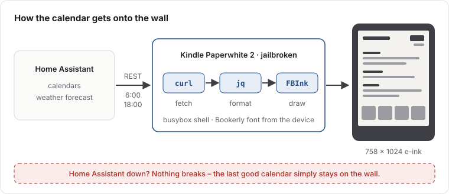

Ein E-Ink-Display ist der perfekte Wandkalender: bei Tageslicht lesbar, kein leuchtendes Panel im Flur, und Strom braucht es nur, wenn sich das Bild ändert. Ich hatte noch einen alten Kindle herumliegen, und Home Assistant kennt unsere Kalender und das Wetter ohnehin. Das Ziel war also einfach: **die Termine der nächsten zwei Wochen plus Wettervorhersage anzeigen, zweimal am Tag aktualisieren – und ich will ihn nicht jeden zweiten Tag laden müssen.**

Die ersten beiden Teile haben einen Tag gedauert. Der dritte zwei Wochen.

Gebaut habe ich das Projekt mit Claude (einer KI), die die eigentliche Arbeit per SSH auf dem Kindle gemacht hat, während ich das Gerät in der Hand hatte, die Entscheidungen getroffen und es ab und zu eingesteckt habe. Das hat das Projekt mehr geprägt als erwartet – mehr dazu am Ende.

## Die Überraschung bei der Hardware

Die erste Lektion kam noch vor dem ersten Code: Der Kindle, den ich für einen Paperwhite 3 hielt, ist ein **Paperwhite 2**. Das Tool `fbink -e` hat den Gerätenamen verraten, und der Unterschied ist wichtig: Der PW2 hat 758×1024 Pixel bei 212 DPI, nicht 1072×1448 bei 300 DPI. Jede Layout-Koordinate hängt davon ab.

Auf dem Gerät läuft Firmware 5.11.2, gejailbreakt mit WinterBreak. Dazu kommen KUAL (ein Launcher für Erweiterungen), usbnet für SSH über WLAN und [FBInk](https://github.com/NiLuJe/FBInk), das Text und Bilder direkt in den E-Ink-Framebuffer zeichnet.

## Warum der Kindle den Kalender selbst zeichnet

Der übliche Weg ist, auf einem Server ein PNG zu rendern und es den Kindle als Bildschirmschoner herunterladen zu lassen. Ich bin den anderen Weg gegangen: **Der Kindle holt die Daten und zeichnet alles selbst.** Er ruft die REST-API von Home Assistant mit `curl` auf, formatiert das Ergebnis mit `jq` und zeichnet es mit FBInk – in der Schrift Bookerly, die ohnehin auf dem Gerät liegt.

Weil der Kindle selbst zeichnet, bleibt der letzte gute Kalender an der Wand. Kein kaputtes Bild, keine Fehlerseite.



Ein paar Dinge, die nicht offensichtlich waren:

- **Die Kindle-Oberfläche muss weg.** Solange das Kindle-„Framework“ läuft, übermalt die Leseoberfläche den Kalender. Es zu stoppen ist kein Problem: WLAN, SSH und die Energieverwaltung laufen weiter.
- **Geisterbilder.** Ein normales Löschen lässt den vorherigen Bildschirm schwach eingebrannt zurück. Nur ein vollständiger, blinkender Refresh (`fbink -f -w -k`) ergibt eine saubere Seite.
- **Spalten mit einer Proportionalschrift.** Ein mit Leerzeichen aufgefüllter Text ist nie bündig. Der Vier-Tage-Streifen der Vorhersage wird deshalb mit vier einzelnen FBInk-Aufrufen an festen x-Positionen gezeichnet.
- **Das aktuelle Home Assistant hat kein `forecast`-Attribut mehr.** Die Vorhersage kommt über den Service-Aufruf `weather.get_forecasts`, und die Antwort steckt in `service_response`.
- **Die Shell ist busybox `ash`.** Keine Prozess-Substitution, und `date` spricht nur Englisch – deutsche Wochentage und Monatsnamen werden im Skript übersetzt.

Nach dem ersten Tag lief es: Termine in der Mitte, aktuelle Temperatur oben rechts, Vier-Tage-Vorhersage unten, Aktualisierung um 06:00 und 18:00, übersteht einen Neustart ohne Eingriff.

Am nächsten Morgen war der Akku leer.

## Der Akku: drei Theorien, zwei davon falsch

Ein Kindle im richtigen Ruhezustand verliert etwa ein Prozent pro Tag. Unserer verlor **drei Prozent pro Stunde**.

Die Schleife funktionierte damals so, wie die meisten Anleitungen es vorschlagen: zeichnen, den Wecker der Hardware-Uhr auf die nächste Aktualisierung stellen, das Gerät mit `echo mem > /sys/power/state` schlafen legen, wiederholen. Das Aufwachen war sekundengenau. Der Akku nicht.

**Theorie 1: das Frontlicht.** Das Framework steuert das Frontlicht, wir hatten das Framework gestoppt, also blieb die zuletzt eingestellte Helligkeit einfach an – gemessen: Stufe 7. Das war echt und wurde behoben (zum Ausschalten braucht es die powerd-Eigenschaft *und* eine 0 im Backlight-Gerät). Verbrauch danach: immer noch 3 % pro Stunde. Falsche Theorie.

**Theorie 2: das WLAN-Modul.** Das WLAN war nach jedem Aufwachen sofort wieder da, das Funkmodul schien also nie abzuschalten. Wir haben den WLAN-Treiber vor jedem Schlafen entladen und danach wieder geladen. Verbrauch: 2,8 % pro Stunde statt 3,0. Auch falsch.

**Theorie 3: unser eigener Schlaf ist zu flach.** Ein Logger, der alle 5 Sekunden schrieb, bewies, dass die CPU wirklich stand – eine saubere Lücke von 181 Sekunden während des Schlafs. Das Gerät *hat* also geschlafen. Die eigentliche Geschichte erzählte aber der Stromsensor des Akkus:

| Zustand | Strom |
|---|---|
| Wach, im Leerlauf | ~62 mA |
| Unser eigener Schlaf (`echo mem`) | ~40 mA |
| Der eigene Schlaf des Kindle (powerd) | ~1,4 mA |

Wer direkt nach `/sys/power/state` schreibt, überspringt alles, was der Energie-Daemon des Kindle (powerd) vor dem Schlafen erledigt – die halbe Hardware bleibt also an. Das war das eigentliche Problem, und es brauchte zwei Wochen und viele Messungen, um es klar zu sehen.

## Der Zielkonflikt, vor dem niemand warnt

Die naheliegende Lösung: nicht selbst schlafen legen, sondern powerd machen lassen. Ergebnis: **0,1 % pro Stunde** – hervorragend – und der Kalender **verpasste jede Aktualisierung.** Der Schlaf von powerd ist tief, aber unser Wecker hat ihn nie geweckt – er schlief 13 Stunden über sein Ziel hinaus.

Also: Unser Schlaf wachte pünktlich auf, leerte aber den Akku. Der Schlaf von powerd schonte den Akku, wachte aber nie auf. Die Bitte an powerd, selbst einen Weckzeitpunkt zu planen (`rtcWakeup`), wurde mit dem Fehler „invalid state“ abgelehnt – egal, was wir versuchten.

## Die Lösung: im richtigen Moment fragen

Der Durchbruch kam durch einen [Artikel auf ragman.net](https://ragman.net) über dasselbe Vorhaben auf einem älteren Kindle: powerd nimmt einen Weckauftrag nur in einem ganz bestimmten Moment an – **direkt bevor er schlafen geht**, wenn er `readyToSuspend` meldet. Fragt man eine Sekunde früher oder später, heißt es „invalid state“.

Das endgültige Design (Version 6, seit Mitte September im Einsatz) legt das Gerät deshalb nie selbst schlafen. Es hört auf die Ereignisse von powerd und antwortet genau im richtigen Moment:


Die Ereignisschleife, vereinfacht:

```sh
# Simplified sketch of the event loop
lipc-wait-event -m com.lab126.powerd readyToSuspend,wakeupFromSuspend |
while read -r event _; do
  case "$event" in
    readyToSuspend)
      # The only moment powerd accepts a wake request. Do this first, nothing else.
      lipc-set-prop -i com.lab126.powerd rtcWakeup "$(( NEXT_REFRESH - $(date +%s) ))"
      ;;
    wakeupFromSuspend)
      # Woken by the alarm, but Wi-Fi stays off: simulate a button press.
      lipc-set-prop -i com.lab126.powerd wakeUp 1
      render_cycle &   # never block the event handler
      ;;
  esac
done
```

Der erste Produktivlauf: 6,4 Stunden geschlafen, um 17:59:51 für die Aktualisierung um 18:00 aufgewacht, etwa **2 mA im Schlaf** und rund 2,6 mA im Schnitt über einen vollen Zyklus inklusive Aufwachen. Das ergibt grob drei Wochen pro Akkuladung statt einem Tag.


Zwei letzte Details zeigten sich erst im Betrieb: Die Hardware-Uhr weckt etwa 9 Sekunden *zu früh*, wodurch die Schleife dieselbe Aktualisierung doppelt zeichnete, bis „knapp daneben“ als erledigt zählte. Und ein eigener Prozess (`blanket`) malte bei jedem Einschlafen von powerd den Standard-Bildschirmschoner über den Kalender – ihm muss nach jedem Neustart gesagt werden, den Bildschirmschoner zu entladen.

## Was ich jedem rate, der das nachbaut

- **Strom messen, nicht Prozente.** Die Akku-Elektronik meldet den Strom während des Schlafs (`dmesg | grep "fg resume"`). Stundenlang darauf zu warten, dass sich die Prozentanzeige bewegt, kostet dich eine Woche.
- **Auf eine Uhrzeit warten, nie auf eine Dauer.** `sleep 43152` läuft nicht weiter, während das Gerät schläft. Eine Aktualisierung ist deswegen komplett ausgefallen.
- **Nicht gegen die Energieverwaltung der Plattform kämpfen.** Mit ihren Ereignissen arbeiten.
- **Über SSH ist `/sbin` nicht im PATH.** `reboot` schlägt dann still fehl. Immer prüfen, ob ein Neustart wirklich stattgefunden hat.
- **Das Log sichern, bevor du es löschst.** Eine ganze Nacht an Beweisen ging so verloren.

## Die Arbeit mit einer KI daran

Das war ein guter Test dafür, was eine KI an echter Hardware leisten kann. Claude hat die SSH-Sitzungen geführt, die Skripte geschrieben, die Messungen aufgesetzt und jede Erkenntnis notiert – auch die falschen, und genau deshalb kann ich diese Geschichte mit Zahlen erzählen. Mein Teil waren die Richtung, die Entscheidungen und der Umgang mit dem Gerät, wenn es nicht erreichbar war.

Was auffiel: Die KI hat bereitwillig eine Theorie aufgestellt – und sie genauso bereitwillig verworfen, wenn die Messung dagegen sprach. Die Theorien zu Frontlicht und WLAN waren beide plausibel und beide falsch, und die Notizen sagen das klar. Die Lösung kam aus der Kombination von Messungen mit dem Blogbeitrag von jemandem, der mit demselben Daemon auf einem anderen Kindle gekämpft hatte.

Seitdem hängt der Kalender an der Wand. Er ist der nützlichste alte E-Reader im Haus.
