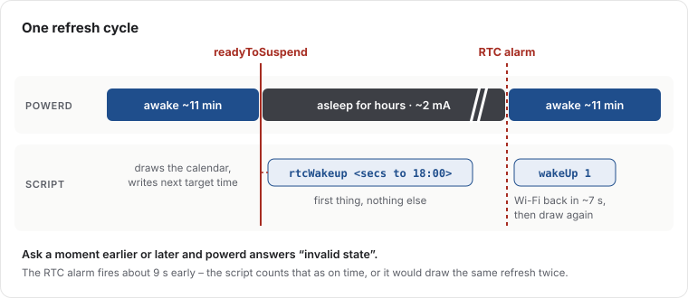
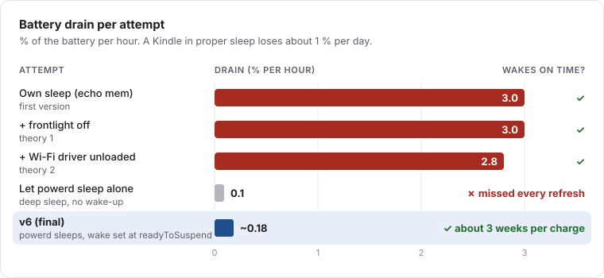

An e-ink screen is the perfect wall calendar: readable in daylight, no glowing panel in the hallway, and it only needs
power when the picture changes. I had an old Kindle lying around, and Home Assistant already knows our calendars and
the weather. So the goal was simple: **show the next two weeks of appointments plus a weather forecast, refresh twice
a day, and don't make me charge it every other day.**

The first two parts took a day. The third took two weeks.

This project was built with Claude (an AI) doing the hands-on work over SSH on the Kindle, while I held the device,
made the decisions and occasionally plugged it in. That shaped the project more than I expected – more on that at the end.

## The hardware surprise

The first lesson came before any code: the Kindle I thought was a Paperwhite 3 is a **Paperwhite 2**. The tool
`fbink -e` reported the device name, and the difference matters: the PW2 screen is 758×1024 at 212 DPI, not
1072×1448 at 300 DPI. Every layout coordinate depends on that.

The device runs firmware 5.11.2 and was jailbroken with WinterBreak. On top of that: KUAL (a launcher for
extensions), usbnet for SSH over Wi-Fi, and [FBInk](https://github.com/NiLuJe/FBInk), which draws text and images
directly to the e-ink framebuffer.

## Why the Kindle renders the calendar itself

The common approach is to render a PNG on a server and let the Kindle download it as a screensaver. I went the other
way: **the Kindle fetches the data and draws everything itself.** It calls the Home Assistant REST API with `curl`,
formats the result with `jq` and draws it with FBInk, using the Bookerly font that is already on the device.

With on-device rendering, the last good calendar stays on the wall. No broken image, no error page.


Some things that weren't obvious:

- **The Kindle UI has to go.** As long as the Kindle "framework" runs, the reading interface repaints over the
  calendar. Stopping it is fine: Wi-Fi, SSH and the power management keep working.
- **Ghosting.** A normal clear leaves the previous screen faintly burned in. Only a full flashing refresh
  (`fbink -f -w -k`) gives a clean page.
- **Columns with a proportional font.** A padded string never lines up. The four-day forecast strip is drawn as four
  separate FBInk calls at fixed x positions.
- **Modern Home Assistant has no `forecast` attribute anymore.** The forecast comes from the `weather.get_forecasts`
  service call, and the response is wrapped in `service_response`.
- **The shell is busybox `ash`.** No process substitution, `date` only speaks English – German day and month names
  are mapped in the script.

After the first day it worked: agenda in the middle, current temperature top right, four-day forecast at the bottom,
refresh at 06:00 and 18:00, survives a reboot unattended.

Then the battery was flat the next morning.

## The battery: three theories, two of them wrong

A Kindle in proper sleep loses about one percent per day. Ours lost **three percent per hour**.

The loop at the time worked like most guides suggest: draw, set the hardware clock alarm to the next refresh, put the
device to sleep with `echo mem > /sys/power/state`, repeat. The wake-ups were accurate to the second. The battery was not.

**Theory 1: the frontlight.** The framework owns the frontlight, we had stopped the framework, so whatever brightness
it had was simply left on – measured at level 7. That was real and got fixed (turning it off needs both the powerd
property *and* writing 0 to the backlight device). Drain afterwards: still 3 % per hour. Wrong theory.

**Theory 2: the Wi-Fi radio.** Wi-Fi came back instantly after every wake, so the radio never seemed to power down.
We unloaded the Wi-Fi driver before each sleep and reloaded it after. Drain: 2.8 % per hour instead of 3.0. Also wrong.

**Theory 3: our own sleep is shallow.** A logger writing every 5 seconds proved the CPU really stopped – a clean
181-second gap during sleep. So the device *was* sleeping. But the battery's current sensor told the real story:

| State | Current |
|---|---|
| Awake, idle | ~62 mA |
| Our own sleep (`echo mem`) | ~40 mA |
| The Kindle's own sleep (powerd) | ~1.4 mA |

Writing to `/sys/power/state` skips everything the Kindle's power daemon (powerd) does before sleeping, so half the
hardware stays powered. That was the actual problem, and it needed two weeks and a lot of measuring to see clearly.

## The trade-off nobody warns you about

The obvious fix: don't sleep ourselves, let powerd do it. Result: **0.1 % per hour** – excellent – and the calendar
**missed every refresh.** powerd's sleep is deep, but our alarm never woke it – it slept 13 hours past its target.

So: our sleep woke on time but drained the battery. powerd's sleep saved the battery but never woke up. Asking powerd
to schedule a wake (`rtcWakeup`) was refused with an "invalid state" error – whatever we tried.

## The fix: ask at the right moment

The breakthrough came from an [article on ragman.net](https://ragman.net) about doing the same on an older Kindle:
powerd only accepts a wake request in one specific moment – **right before it goes to sleep**, when it announces
`readyToSuspend`. Ask a second earlier or later and it's "invalid state".

So the final design (version 6, in production since mid-September) never puts the device to sleep itself. It listens to
powerd's events and answers at exactly the right time:



The event loop, simplified:

```sh
# Simplified sketch of the event loop
lipc-wait-event -m com.lab126.powerd readyToSuspend,wakeupFromSuspend |
while read -r event _; do
  case "$event" in
    readyToSuspend)
      # The only moment powerd accepts a wake request. Do this first, nothing else.
      lipc-set-prop -i com.lab126.powerd rtcWakeup "$(( NEXT_REFRESH - $(date +%s) ))"
      ;;
    wakeupFromSuspend)
      # Woken by the alarm, but Wi-Fi stays off: simulate a button press.
      lipc-set-prop -i com.lab126.powerd wakeUp 1
      render_cycle &   # never block the event handler
      ;;
  esac
done
```

The first production run: slept 6.4 hours, woke at 17:59:51 for the 18:00 refresh, about **2 mA while asleep** and
roughly 2.6 mA averaged over a full cycle including the wake-up. That works out to roughly three weeks per charge
instead of one day.



Two last details showed up in production: the hardware clock wakes about 9 seconds *early*, which made the loop draw
the same refresh twice until "close enough" counted as done. And a separate process (`blanket`) painted the stock
screensaver over the calendar whenever powerd went to sleep – it has to be told to unload the screensaver after every boot.

## What I'd tell anyone trying this

- **Measure current, not percentages.** The fuel gauge reports the current during sleep (`dmesg | grep "fg resume"`).
  Waiting hours for the battery percentage to move is how you lose a week.
- **Wait for a clock time, never for a duration.** `sleep 43152` doesn't advance while the device is asleep. One
  refresh vanished completely because of that.
- **Don't fight the platform's power manager.** Work with its events.
- **Over SSH, `/sbin` isn't in the PATH.** `reboot` fails silently. Always check that a reboot really happened.
- **Keep the log before deleting it.** One night of evidence got lost that way.

## Working with an AI on this

This was a good test of what an AI can do on real hardware. Claude did the SSH sessions, wrote the scripts, set up the
measurements and kept notes of every finding – including the wrong ones, which is why I can tell this story with
numbers. My part was the direction, the decisions, and physically handling the device when it was unreachable.

What stood out: the AI was happy to state a theory, and just as happy to drop it when the measurement disagreed. The
frontlight and Wi-Fi theories were both plausible and both wrong, and the notes say so plainly. The fix came from
combining measurements with a blog post from someone who had fought the same daemon on a different Kindle.

The calendar has been on the wall since. It's the most useful old e-reader in the house.
