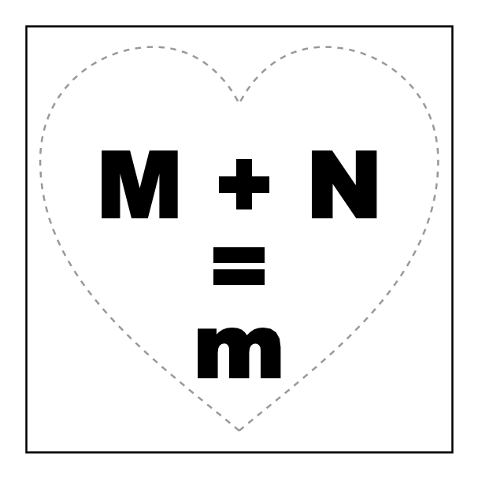
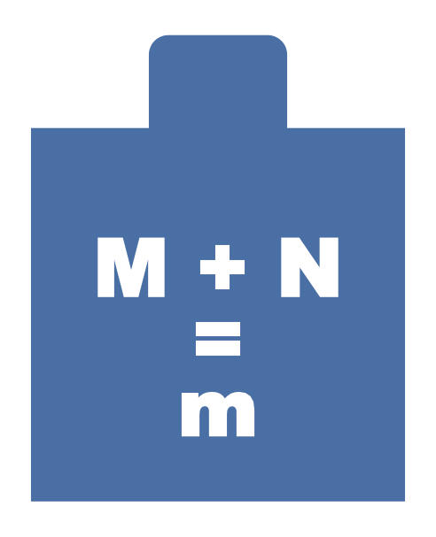
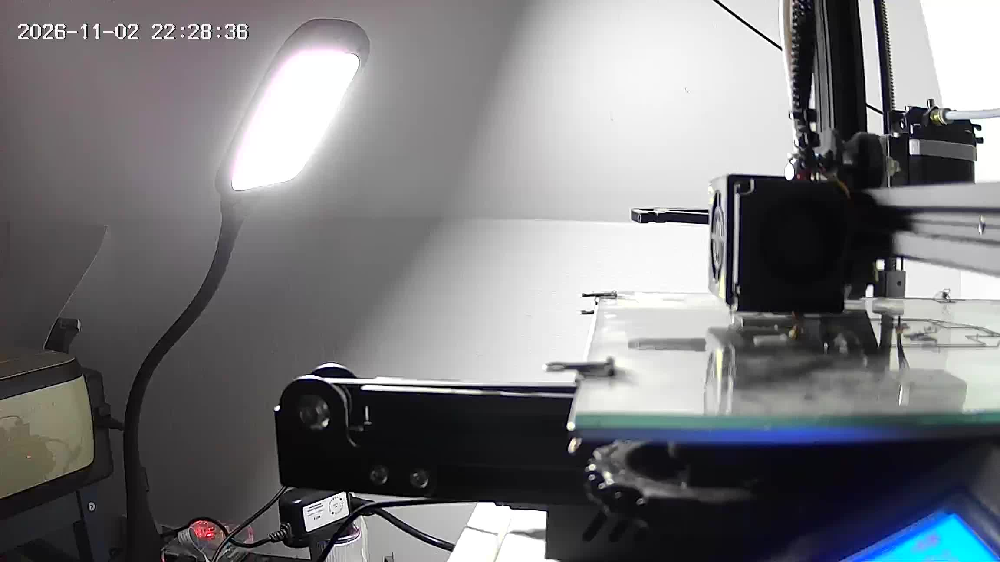
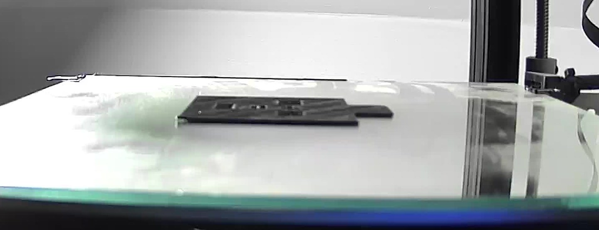
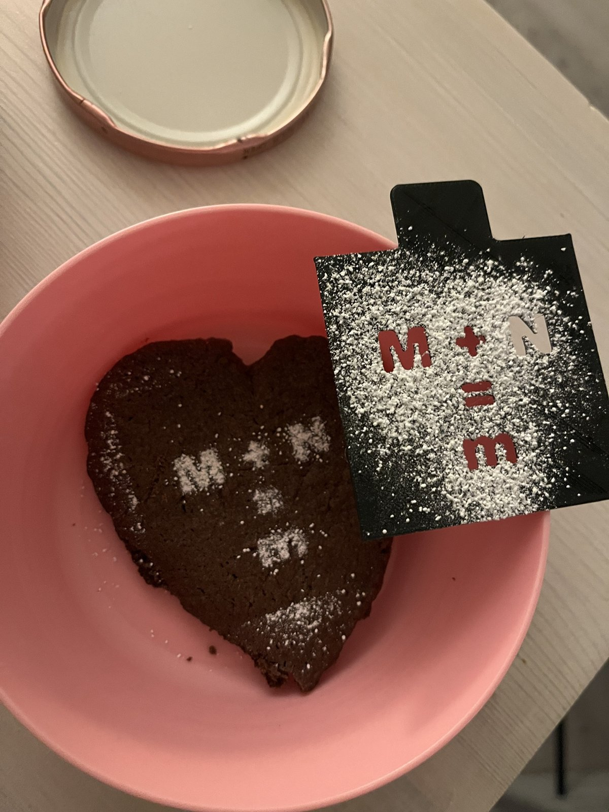

Es war Montagabend, und ich war an einem Kuchen für meine Frau dran. Der Kuchen war herzförmig und sollte oben eine
kleine Puderzucker-Schablone bekommen: `M + N`, ein Gleichheitszeichen und darunter ein `m`. Sechs mal sechs
Zentimeter, unten schmaler, damit es zum Herz passt. Und es musste schnell gehen.

Genau das habe ich in Claude Code getippt, samt einer dreizeiligen ASCII-Skizze, und „gib gas“ dahinter.

## Version 1: eine Seite zum Ausdrucken

Die erste Antwort war eine schlichte HTML-Seite mit einer SVG-Grafik. SVG kennt echte Maßeinheiten, das Quadrat ist
also genau `60mm × 60mm` groß und kommt in Originalgröße aus dem Drucker – sofern man mit 100 % druckt und nicht
„An Seite anpassen“ wählt. Schwarz wird ausgeschnitten, ein gestricheltes Herz zeigt, wo der Kuchenrand liegt.



Ich wollte nur eine Änderung: das untere `M` als kleines `m`. Eine Änderung, fertig.

## Papier oder Plastik?

Dann die eigentliche Frage: auf Papier drucken und ausschneiden, oder mit dem 3D-Drucker?

Claudes Einschätzung: Papier ist schneller gedruckt, aber 9 mm große Buchstaben mit dem Cutter auszuschneiden ist
Fummelei, und Papier wellt sich, sodass der Zucker unter die Kanten kriecht. Eine 0,8 mm dünne Plastikplatte bleibt
flach, hat saubere Kanten, lässt sich abwaschen und braucht auf dem Drucker etwa eine Viertelstunde. Außerdem hat es
das eine geprüft, was eine Schablone ruinieren kann: Buchstaben mit Innenflächen wie `O` oder `A`, deren Mitte
herausfallen würde. `M`, `N`, `m`, `+` und `=` haben keine, das Design funktioniert also so, wie es ist.

Also Plastik. Ich wollte noch eine kleine Lasche oben, damit man die Schablone gerade nach oben abheben kann, ohne den
Zucker zu verwischen.

## Von Buchstaben zum 3D-Modell

Das Modell entsteht mit einem kurzen Python-Skript statt in einem CAD-Programm:

- `TextPath` aus `matplotlib` macht aus dem Text in Arial Black Umrisse in Millimetern.
- `shapely` schneidet diese Umrisse aus einem 60 × 60 mm großen Quadrat plus abgerundeter Lasche.
- `trimesh` extrudiert das Ergebnis auf 0,8 mm und schreibt eine STL-Datei.

```python
cut = unary_union([
    text_geom("M + N", 13, 30, 27),
    text_geom("=", 13, 30, 38.5),
    text_geom("m", 13, 30, 49.5),
])
plate = box(0, 0, 60, 60).union(tab)
stencil = plate.difference(cut)
mesh = trimesh.creation.extrude_polygon(stencil, 0.8)
```

Das Skript prüft, dass das Ergebnis ein einziges Teil mit genau sechs Löchern ist (M, +, N, zwei Balken des `=`, m)
und dass das Netz geschlossen ist, damit der Slicer nicht meckert.



## Den Drucker wecken

Mein Ender 3 läuft mit Klipper auf einem Raspberry Pi und hat eine eigene smarte Steckdose in Home Assistant. Claude
hat die Steckdose über die Home-Assistant-API eingeschaltet. Klipper hatte das Board verloren, während der Drucker aus
war, und brauchte ein `FIRMWARE_RESTART`. Danach heizten Bett und Düse schon auf, während das Modell noch entstand.

Vor jedem Start holt sich Claude ein Standbild der Kamera neben dem Drucker und prüft, ob das Bett leer ist.



## Versuch eins: Spaghetti

Der erste G-Code kam aus der Kommandozeile von PrusaSlicer, alle Einstellungen als Parameter, ohne meine gespeicherten
Profile. In Sekunden geslict, per `scp` auf den Pi kopiert und über Klippers virtuelle SD-Karte gestartet:

```bash
SDCARD_PRINT_FILE FILENAME=schablone-MN.gcode
```

Eine Minute in die erste Schicht hinein wurde daraus Spaghetti. Ich habe abgebrochen.

Erster Verdacht war der Slicer: Das waren spontan eingetippte Werte, nicht die, die auf diesem Drucker schon
funktionieren.

## Versuch zwei: das bewährte Profil

Der zweite Slice lief deshalb mit meinem gespeicherten OrcaSlicer-Profil über Orcas Kommandozeile. Das braucht ein
paar Tricks: Die Profile erben von eingebauten Creality-Profilen, und die Kommandozeile nimmt sie erst, wenn sie zu
eigenständigen Dateien zusammengeführt sind. Netzwerkadresse und API-Key des Druckers fliegen dabei raus. Ergebnis:
vier Schichten, 220 °C für die erste bei 30 mm/s, etwa 17 Minuten.

Wieder Spaghetti, wieder in der ersten Schicht.

Das war der nützliche Fehlschlag. Wenn zwei verschiedene Slicer gleich scheitern, liegt es nicht am G-Code. Das
Klipper-Log zeigte keine Fehler und stabile Temperaturen, das Plastik hielt also einfach nicht auf dem Glas. Ein so
dünnes Teil – vier Schichten mit schmalen Stegen zwischen den Buchstaben – hat nichts mehr, woran es sich festhalten
kann, wenn die erste Schicht loslässt. Und ich hatte das Glas gerade zweimal angefasst, beim Entfernen der Fehldrucke.

## Versuch drei: sauberes Glas, langsame erste Schicht

Ich habe das Glas geputzt. Claude hat mit zwei Änderungen am bewährten Profil neu geslict: erste Schicht mit 20 statt
30 mm/s, Bett auf 65 statt 60 °C.

Diesmal blieb die erste Schicht liegen. Zwanzig Minuten später lag die Schablone samt Lasche flach auf dem Glas, und
die Steckdose des Druckers schaltete sich ab, sobald die Düse abgekühlt war.



## Erster Einsatz

Als Erstes bekam nicht der Kuchen selbst die Schablone, sondern ein Herz-Keks, gebacken aus den Teigresten vom
Kuchenboden. Schablone knapp über die Oberfläche halten, Puderzucker drüberstäuben und an der Lasche gerade nach
oben abheben.



## Was ich mitnehme

- Für ein schnelles Einzelstück reichte es, die Form in drei Zeilen ASCII-Art zu beschreiben.
- Eine Schablone ist ein guter 3D-Druck-Job: flach, keine Stützen, in Minuten fertig und wiederverwendbar.
- Wenn zwei verschiedene Slicer gleich scheitern: nicht weiter am Slicer drehen, sondern aufs Bett schauen.
- Dünne Flachteile sind reine Erste-Schicht-Sache. Sauberes Glas und eine langsame erste Schicht zählen mehr als jede
  andere Einstellung.
- Wenn der Drucker an einer smarten Steckdose hängt und per Skript erreichbar ist, ist „druck das“ wirklich die ganze
  Anweisung.
