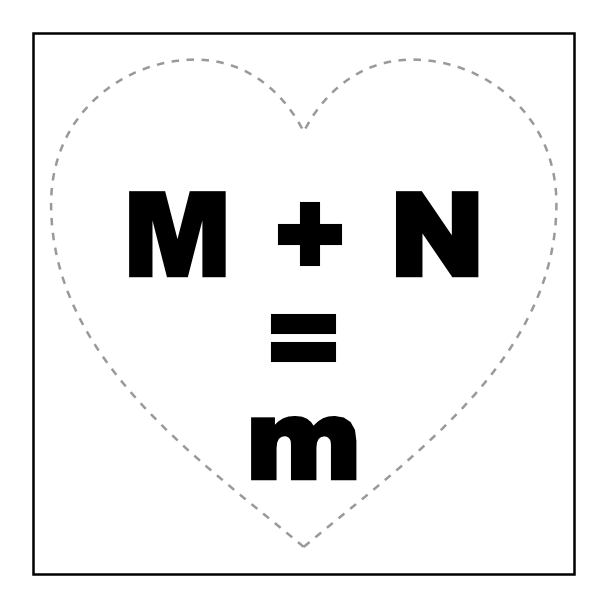
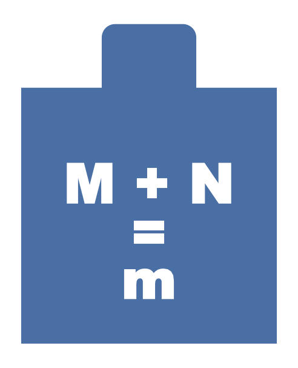
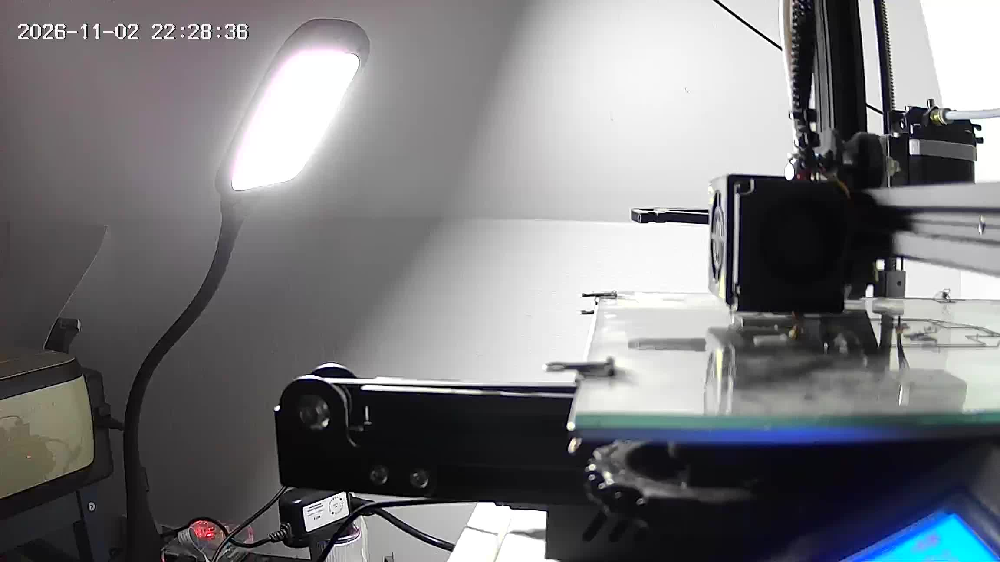
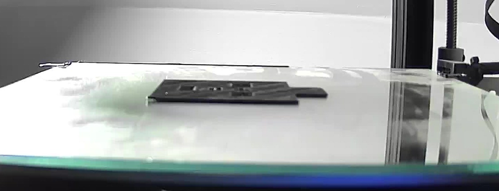

It was a Monday evening and I had a cake for my wife in the works. The cake was heart-shaped and needed a small
powdered-sugar stencil on top: `M + N`, an equals sign, and an `m` below it. Six by six centimetres, narrower at the
bottom so it follows the heart. And it had to be quick.

So I typed exactly that into Claude Code, including a three-line ASCII sketch, and added "gib gas" (German for "step on
it").

## Version 1: a page to print

The first answer was a plain HTML page with an SVG in it. SVG has real units, so the square is set to exactly
`60mm × 60mm` and prints at true size, provided you print at 100 % and don't pick "fit to page". Black is what you cut
out, and a dashed heart shows where the cake's edge will be.



I only asked for one change: make the bottom `M` a lowercase `m`. One edit, done.

## Paper or plastic?

Then the real question: should I print this on paper and cut it out, or print it on the 3D printer?

Claude's take: paper is quicker to print, but cutting out 9 mm letters with a craft knife is fiddly, and paper
curls, so the sugar creeps under the edges. A 0.8 mm plastic plate stays flat, has clean edges, survives washing and
takes about a quarter of an hour on the printer. It also checked the one thing that can ruin a stencil: letters with
holes inside them, like `O` or `A`, whose middle would fall out. `M`, `N`, `m`, `+` and `=` have none, so the
design works as is.

So, plastic. I asked for a small tab at the top so the stencil can be lifted straight up without smudging the sugar.

## From letters to a 3D model

The model is generated with a short Python script rather than drawn in CAD:

- `matplotlib`'s `TextPath` turns the text in Arial Black into outlines, in millimetres.
- `shapely` cuts those outlines out of a 60 × 60 mm square plus a rounded tab.
- `trimesh` extrudes the result to 0.8 mm and writes an STL file.

```python
cut = unary_union([
    text_geom("M + N", 13, 30, 27),
    text_geom("=", 13, 30, 38.5),
    text_geom("m", 13, 30, 49.5),
])
plate = box(0, 0, 60, 60).union(tab)
stencil = plate.difference(cut)
mesh = trimesh.creation.extrude_polygon(stencil, 0.8)
```

The script checks that the result is one piece with exactly six holes (M, +, N, two bars of the `=`, m), and that
the mesh is watertight, so the slicer won't complain.



## Waking up the printer

My Ender 3 runs Klipper on a Raspberry Pi and has its own smart plug in Home Assistant. Claude switched the plug on
through the Home Assistant API. Klipper had lost the board while the printer was off, so it needed a
`FIRMWARE_RESTART`. After that, the bed and nozzle started heating while the model was still being made.

Before every start, Claude grabs a still from the camera next to the printer to check that the bed is empty.



## Attempt one: spaghetti

The first G-code came from PrusaSlicer's command line, with all settings passed as parameters and none of my saved
profiles. It sliced in seconds, went to the Pi with `scp`, and started via Klipper's virtual SD card:

```bash
SDCARD_PRINT_FILE FILENAME=schablone-MN.gcode
```

A minute into the first layer, it turned to spaghetti. I hit cancel.

The first suspect was the slicer: those were settings typed in on the spot, not the ones that already work on this
printer.

## Attempt two: the proven profile

So the second slice used my saved OrcaSlicer profile through Orca's command line, which takes a few tricks: the
profiles inherit from built-in Creality profiles, and the CLI only accepts them once they are merged into
self-contained files. The printer's network address and API key are stripped out along the way. The result: four
layers, 220 °C for the first one at 30 mm/s, about 17 minutes.

Spaghetti again, in the first layer again.

That was the useful failure. Two different slicers failing the same way meant the G-code wasn't the problem. The
Klipper log showed no errors and steady temperatures, so the plastic simply wasn't sticking to the glass. A part this
thin, four layers with narrow bars between the letters, has nothing to hold on to once the first layer lets go. And I
had just touched the glass twice, pulling off the failed attempts.

## Attempt three: clean glass, slow first layer

I cleaned the glass. Claude re-sliced with two changes to the proven profile: the first layer
at 20 mm/s instead of 30, and the bed at 65 °C instead of 60.

This time the first layer stayed down. Twenty minutes later the stencil sat flat on the glass, tab and all, and
the printer's plug switched itself off once the nozzle had cooled down.



## What I took away

- For a quick one-off, describing the shape in three lines of ASCII art was enough.
- A stencil is a good 3D-printing job: flat, no supports, done in minutes, and it can be used again.
- When two different slicers fail the same way, stop changing the slicer and look at the bed.
- Thin, flat parts are all first layer. Clean glass and a slow first layer matter more than any other setting.
- Having the printer on a smart plug and reachable from a script means "print this" really is the whole instruction.
