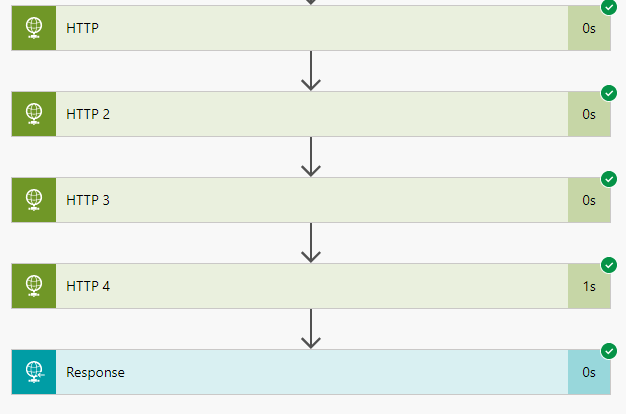
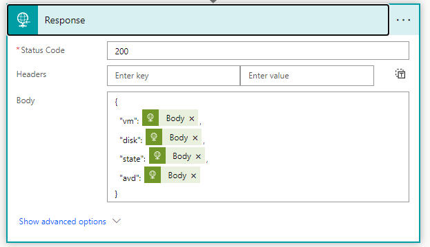

Today I was looking at running multiple HTTP requests and combine all of the data into one JSON object in Power Automate to respond back to my PowerApp.

I was browsing through various blogs and articles but didn’t find an efficient solution that didn’t require a lot of steps or complicated data manipulation. I wanted to simply return the object from Response, without doing any kind of apply for each or any other sorcery in between.

My problem was though, that some of HTTP return objects had the same schema. In the beginning I was kind of successful using the `union(outputs('HTTP')['body'], outputs('HTTP_2')['body']` function. But this only helped for JSON objects that had a different schema as union would simply overwrite properties if they would have the same name.

After some struggle I thought why not simply building my own schema and referring to the output of the HTTP queries. And it worked! Power Automate can be so simple. Keeps amazing me 🙂

That way I was able to append or combine all JSON objects from my HTTP calls into one response and then properly process it from the calling PowerApp. Cool stuff!
