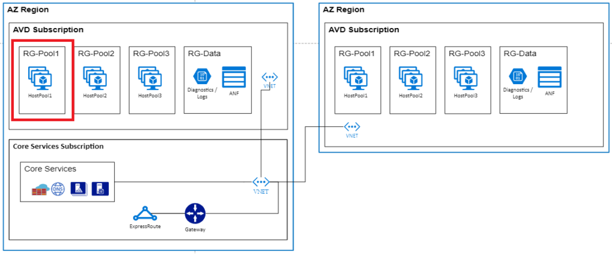
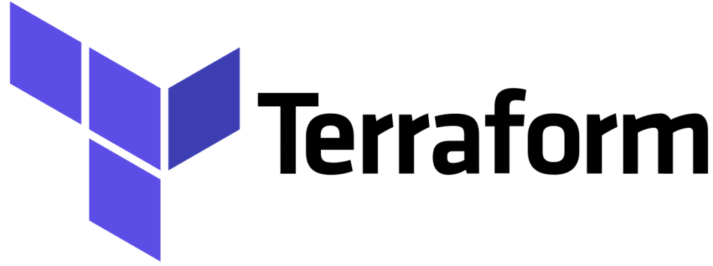
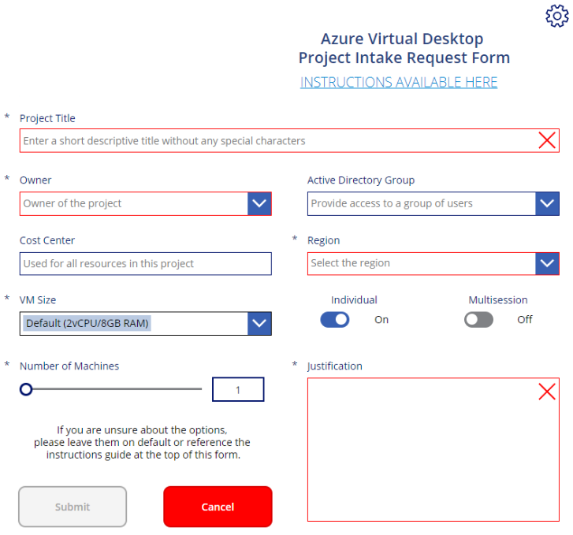
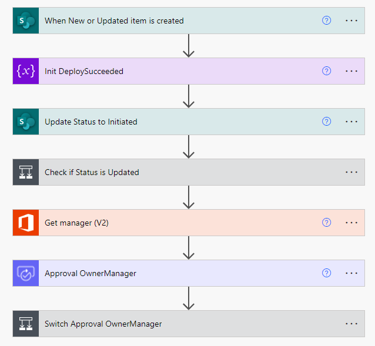
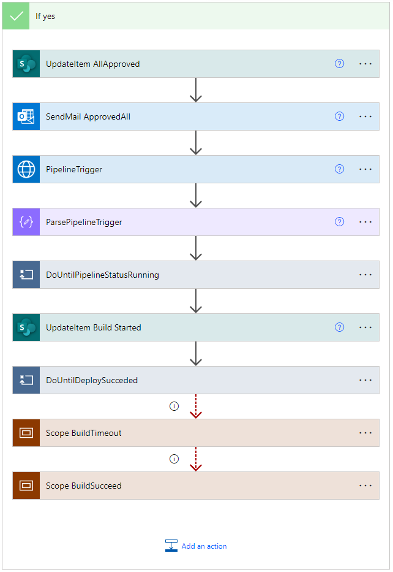

## Streamlining your AVD Project Intakes

Welcome to Part 1 (Frontend) of my multi-part series of automating your project intake request process. This article describes how to automatically roll-out AVD hostpools based on (M365) user input. I will try to give you a good enough picture so you can replicate but have in mind, there are so many specifics about how we implement all of these technologies, this will not be an easy to copy guide at all! See it as a blueprint and change technologies / steps where needed. I see a lot of folks using ADO as their CI/CD tool or maybe even use Bicep as the IaC tool. Probably all of this can work. By no means is this the perfect solution but it helped us automating a lot of our work.

Table of Contents

- [My problem](#my-problem "My problem")
- [The design](#the-design "The design")
- [Our requirements](#our-requirements "Our requirements")
- [My solution](#my-solution "My solution")
- [Frontend](#frontend "Frontend")
  - [Sharepoint](#sharepoint "Sharepoint")
  - [PowerApps](#powerapps "PowerApps")
  - [Flow](#flow "Flow")

### My problem

I am working for quite a big company that works with numerous vendors, which process a variety of tasks for us. The vendors we work with get (A)AD accounts from us but not hardware. Most of them have to get access to our internal systems. We have been using Horizon View for this since almost a decade but now Azure Virtual Desktop became our new standard. When on-boarding new vendors, we want to separate them out into their own Resource Group, AVD Host Pool, Storage Accounts and so on. Every vendor has different requirements so we need to be able to separate them.

### The design

That’s a rough diagram of our setup. We will focus on the red circle. Everything else is already stood up by our enterprise architecture group and we tap into it.

*basic architecture*

The red circle will include:

- Resource Group
- Host Pool
- Virtual Machine(s)
- DSC extensions for domain join and host pool join

### Our requirements

- Let users request their own AVD pools (for either new projects, new vendors that they hired or simply for testing AVD)
- These requests need to go through an approval process (cost center owner)
- Deployment needs to be consistent with our Azure landing zone policy (tags, naming, etc.)
- State files need to be kept in case the requester wants to modify the number of machines or my team wants to cleanup the pool again

### My solution

We want to use an IaC automation. Even better, a solution users can self-service. And in best case (yes there is more) that whole process should be happening in a quality controlled manner, where changes can be done and tested without impacting production. While our host pools are all connected to the same infrastructure, you can use the below concept to create separate vnets & subnets and put NSGs on them. All possible! Tool wise, we defined Gitlab.com as our Devops tool for pretty much all automation projects. And since we are also a Microsoft shop, I simply made use of the apps that come with that toolkit. So that is what I went with and what are the requirements for this blog post.

**Frontend**: Sharepoint, Powerapp and Flow

*Frontend Logos*

**Codebase & CI/CD**: Gitlab

*Gitlab logo*

**IaC**: Terraform

*terraform logo*

### Frontend

#### Sharepoint

First steps first. We have to create something that users can enter their data in and that keeps a history of records. While PowerApps is a very complex tool, all we have to start with is creating a Sharepoint List. Setup that list with the columns required for your project. A good list of columns to start with:

- ProjectTitle (Single line of text)
- Owner (Person or Group)
- Justification (Multiple lines of text)
- Region (Choice)
- Number of Machines (Number)
- CostCenter (Single line of text)

In addition to this list you will have more columns automatically added by Sharepoint that we are going to use later (i.e. CreatedBy or ID). We can also add more features like Spot instances for validation environments, Multisession or Singlesession deployments or even adding a column for choosing VM_Size. But that will be part of an advanced section 🙂

#### PowerApps

After you have setup the Sharepoint List you can start adding a PowerApps Form frontend. To do that click on “**Integrate > Power Apps > Customize** **Forms**“. Feel free to add whatever you need as information for deploying your project later. For a start Project Title, Owner, Cost Center and Region is enough to start with.

Below is an example of my production form.

*powerapps example*

#### Flow

Flow will be the frontend brain. When a user submits above form, a new sharepoint list item will be created. Once that item is created, Microsoft flow will trigger and pick up the work. We will be using flow for managing the user facing interaction through O365 and handover to Gitlab using the Pipeline Trigger API. Below is an example of the flow we are using to give you a quickstart.

**Watchout:** To make API calls you have to have a flow premium license assigned to the owner of the flow. The good news is, you only need one, no matter how many people use the Powerapp that feeds it.

*flow example*

If the manager of the Owner approves, the next flow kicks off that’s doing the actual work.

*if approved*

As you can see we are doing some maintenance during the flow, like updating the state in the status column or sending out emails to update users during the status. The magic really happens inside the PipelineTrigger step though. This is where we call the Gitlab API to handover our payload (the user input) to terraform. Its then repeatedly calling the Gitlab API to report on the status of the pipeline. If it succeeds, that’s fine; if not, we will send a message to the AVD team to check whats going on.

> The pipeline trigger as an example below. The <> values come from dynamic fields in flow.
>
> [https://www.gitlab.com/api/v4/projects/1234/trigger/pipeline?token=xxxxxxxx&ref=<branch-name>&[variables]projectTitle=<projectTitle>&[variables]owner=<Owner>&[variables]CostCenter=<CostCenter>&[variables]Region=<Region>](https://www.gitlab.com/api/v4/projects/1234/trigger/pipeline?token=xxxxxxxx&ref=%3Cbranch-name%3E&[variables]projectTitle=%3CprojectTitle%3E&[variables]owner=%3COwner%3E&[variables]CostCenter=%3CCostCenter%3E&[variables]Region=%3CRegion%3E)

This should cover the frontend aspect for now. In the next article i’ll explain more about setting the up the Gitlab pipeline.
